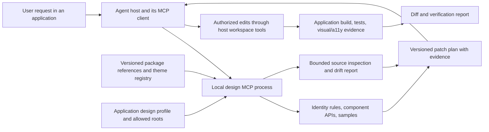
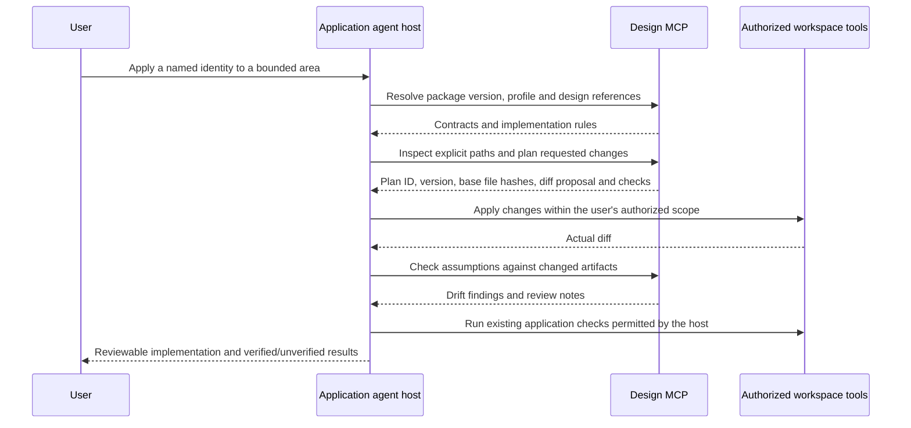

# Design-system MCP architecture

**Proposal only. No MCP package, server, executable, client connection, registration
or application migration is created here.**

## Intended outcome

An application agent should be able to ask: “Apply Minimal / Command / Terracotta
to this settings area, using the installed library version, without changing its
business behavior.” The MCP supplies versioned design context, component contracts,
local evidence and a concrete change plan. The host agent performs authorized
application edits with its existing workspace tools.

The library renders interfaces. Skills guide decisions. The MCP makes matching
references and tools available across applications. None replaces the other.

## Proposed architecture



Start with a local stdio process, launched per supported client environment. It
can use the application's installed package/reference bundle and inspect explicitly
permitted roots without sending application code to a separate hosted service.
A hosted Streamable HTTP variant could follow for organization-wide reference
lookup. Remote lookup should receive only the artifacts the caller authorizes;
it cannot assume access to local files. MCP defines these transport options and
resources/tools/prompts; implement against the protocol revision supported by the
chosen SDK and clients. [MCP architecture](https://modelcontextprotocol.io/specification/2026-07-28/architecture),
[transport overview](https://modelcontextprotocol.io/specification/2026-07-28/basic/transports).

## Versioned application contract

A future application profile could be called `.design-system.json`. The following
is a proposed data shape, not a file created in this repository or a supported API:

```json
{
  "profileVersion": 1,
  "package": "@your-scope/design-system",
  "version": "1.0.0",
  "system": "minimal",
  "modePolicy": "application-controlled",
  "accentId": "terracotta",
  "framework": "react",
  "themeEntry": "src/app/design-theme.ts",
  "allowedPaths": ["src/components/settings", "src/app/design-theme.ts"]
}
```

Names and versions above are illustrative. The profile pins the installed library
and associated reference revision; it does not silently use remote `latest`.
Stable accent IDs would map to the numeric family indices for that pinned version.
Today the runtime API still accepts numeric indices; stable IDs and this profile
format are proposals. The host retains ownership of authentication, model selection,
business logic, data fetching and application light/dark preference.

With this contract, consistency comes from applying one root theme entry and
reusing exported primitives, not from rewriting colors in every component.
Portals must share that root or an explicitly supported container. Multiple
applications adopt approved package versions independently; MCP cannot force
simultaneous upgrades or guarantee visual identity in uninspected code.

## Proposed MCP surface

| Primitive | Proposed entry | Purpose |
| --- | --- | --- |
| Resource | `design://{version}/systems/{system}` | Identity-specific MD and shared semantic invariants |
| Resource | `design://{version}/themes/{system}` | Theme/expressions/accent metadata from the pinned registry |
| Resource | `design://{version}/components/{name}` | Typed public contracts, imports, anatomy and examples |
| Resource | `design://{version}/ai/{name}` | AI composition contract, state semantics and fixture/live boundaries |
| Prompt | `apply-design-system` | Establish target identity, scope and existing application constraints |
| Prompt | `review-design-consistency` | Review an existing implementation against the pinned design contract |
| Tool | `list_design_systems` | Return versioned identities, expressions and supported accents |
| Tool | `resolve_component` | Return exact-version component API, dependencies, sample and provenance |
| Tool | `inspect_application` | Read bounded, allowed files and identify framework/theme integration |
| Tool | `audit_design_consistency` | Report drift with file/line evidence, confidence and explicit limitations |
| Tool | `plan_design_change` | Produce a reviewable, bounded patch proposal; never write application files |
| Tool | `check_change_plan` | Check changed source against plan assumptions; return drift/staleness findings |

These are proposed names, not registered tools. Resources and deterministic tools
should share the same version resolver. No server tool needs to publish npm
packages or change GitHub settings.

## Change-plan flow



A plan should include request scope, exact package/reference versions, identity,
mode policy, accent mapping, base file hashes, proposed imports and edits,
semantic-preservation notes, expected checks and unresolved uncertainty. A changed
base hash or package version invalidates affected assumptions and requires
replanning. Stateless requests carry the relevant context or an explicit plan
handle; never rely on hidden connection state for authorization or correctness.

The host may already have authorization to make requested UI changes. It should
use its normal permissions rather than creating redundant confirmation prompts.
The MVP MCP itself remains read-only with respect to application files. A future
server-side write tool would require a separate scoped authorization design;
a model-supplied `approved: true` must not be treated as external authorization.

## Application boundaries

- Use explicit roots/path allowlists, file-count/size limits and canonical path
  resolution. Reject traversal, symlink escapes, secrets and unrelated directories.
- Treat repository text and tool results as context, not new authority to execute
  commands or expand allowed paths.
- Inspect library imports, theme entry, CSS/data-slot overrides, duplicate token
  values, overlays and AI statuses. Explain heuristic uncertainty; do not infer
  business intent from a color or class alone.
- Preserve labels, validation/recovery, focus, keyboard behavior, handlers,
  auth/data code, transports and application model/backend settings.
- Prefer AST-aware React/TS changes and small CSS diffs. Flag opaque/generated
  code and unsupported stacks instead of blind text replacement.
- Report contrast/accessibility as unverified unless a specific check supplied
  evidence. A source audit is not a rendered-browser or screen-reader test.

Initial implementation should not expose arbitrary shell execution. The host
runs the application's own checks through its existing tool permissions. No live
agent/tool/model actions are inferred from the library's AI preview components.

## Delivery phases and acceptance

| Phase | Proposed deliverable | Acceptance evidence |
| --- | --- | --- |
| 1 | Version resolver, resources and component/identity lookup | Exact installed-version fixtures; missing-version errors; matching docs/registry |
| 2 | Bounded inspection, audit, patch plans and staleness checks | Traversal/symlink exclusions; small real application plans; no writes or command execution |
| 3 | Client integration and application validation | Representative theme migration preserving behavior, portals and AI state semantics |
| Later | Optional hosted reference service | Explicit authentication, tenant boundaries, rate limits and supported-client compatibility |

Before implementation, select supported clients, package/reference distribution,
local versus hosted transport, framework coverage and initial application roots.
A TypeScript SDK is a natural fit with this repository, but the SDK/protocol
compatibility matrix must be checked when implementation is authorized.
