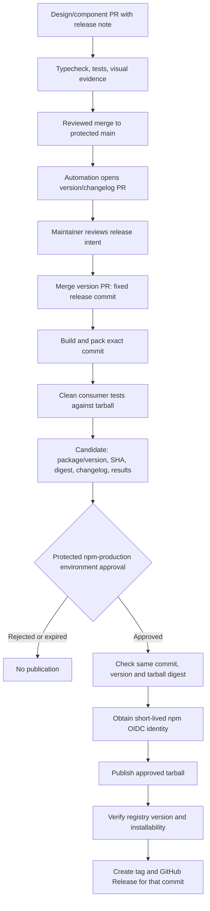

# npm packaging and approval-based release architecture

The package build, Changesets version PRs, candidate testing and approval-gated
publication workflows are implemented locally. GitHub/npm settings and the first
remote release have not been verified. See [release setup](RELEASE_SETUP.md) and
[the publishing checklist](NPM_PUBLISHING_CHECKLIST.md) (14 of 20 ready).
The sections below retain the architectural rationale; setup instructions govern
the implemented workflow.

## Recommended package boundary

Publish the approved `@inverse_ratio/design-system` library from `packages/react/`.
The owner selected public access and MIT. npm permissions remain unverified.
Keep the repository root, both apps, and the native reference library private.
Bundle the theme data required by the React runtime into the library distribution.
This avoids requiring consumers to install another tightly coupled package.

A separate foundations package can follow if independent consumers justify it.
The MCP server would be another product/artifact, not a browser dependency of the UI.
Skills and design references should ship as versioned data assets or a separately
versioned reference bundle so future agents can resolve the same design contract.

## Actual readiness gaps

| Area | Current readiness |
| --- | --- |
| Visibility/identity | Library configured public/MIT; root/apps remain private; scope access unverified |
| JavaScript/declarations | Implemented: `build:lib`, ESM entries and declaration output |
| Self-contained data/exports | Implemented: `dist` subpaths, embedded/copied theme data, clean tarball imports |
| React peers | Implemented: external React/React DOM peers and single-instance verification |
| CSS | Implemented: compiled/scoped CSS, optional reset, no consumer Tailwind requirement |
| Package contents | Explicit file allowlist, MIT license and upstream provenance included |
| Consumer tests | Implemented: fresh tarball install, strict types/build, five Playwright functional tests |
| Release automation | Implemented locally: version/candidate workflows, protected publish and retry guards |
| Account setup | Unverified: npm ownership/trust and GitHub reviewers/environment protection |

See [the implementation and tests](PACKAGE_BUILD_AND_TESTING.md) for the current
artifact contract. The remote approval/OIDC path still requires account setup and verification.

Proposed public entry points: `ui/*`, `ai`, `theme`, `styles.css`, and versioned
reference data. Peer React/React DOM and supported framework requirements must
be explicit. Publish compiled CSS for consumers; a separate optional Tailwind
source entry may serve advanced customization. The package must not depend on
the gallery's Tailwind scan or raw TSX to render correctly.

## Automated flow with a human publish gate

Recommended version intent is a Changesets-style release note in a PR. This is
an architectural choice, not an installed tool. Version/changelog automation
prepares a release; it does not grant permission to publish. A manually dispatched
candidate could use the same protected publish job, but dispatch alone is not
reviewer approval.

The release candidate must show a concrete artifact: exact package name/version,
source commit, tarball SHA-256, changed identities/components, changelog, consumer
results and relevant visual evidence. The publish job must use that artifact,
not rebuild from whatever `main` contains after approval. A changed digest,
changed release commit, expired/deleted artifact, or superseded candidate requires
a new candidate and approval. npm package versions are treated as immutable;
fixes ship in a new version, rather than retrying an ambiguous overwrite.

## Approval and authentication

Use a GitHub environment named `npm-production`, with designated required
reviewers, self-review prevention and release-branch restrictions where supported.
An administrator must configure its protection rules; naming an environment in
YAML alone is not an approval gate. Availability depends on repository visibility
and GitHub plan; resolve that before implementation. [GitHub environment documentation](https://docs.github.com/en/actions/how-tos/deploy/configure-and-manage-deployments/manage-environments).

After the gate, prefer npm trusted publishing through a GitHub-hosted runner,
restricted to the intended repository, workflow filename and environment. Grant
OIDC permission only to the publish job. The current documented minimum is npm
11.5.1 and Node 22.14; proposed CI would pin Node 24 and a supported npm version.
Public-repository/public-package conditions affect npm provenance availability.
Check npm's current package-creation/bootstrap and trusted-publisher requirements
when configuring the first release. [npm trusted publishing](https://docs.npmjs.com/trusted-publishers/).

A PR review, a release-PR merge and a publish-job approval have different roles.
Only the last releases the prepared artifact. Do not place a publisher in
untrusted PR execution. Proposed permissions: read-only checks; narrowly scoped
repository write access for version PRs/releases; OIDC on the publish job only.
Action versions and the lockfile should be pinned in the eventual implementation.

## Failure and recovery

- Serialize candidates per public package; prevent an older pending candidate
  from publishing after a newer approved one without renewed review.
- Before retrying a failed publish, check whether the registry already has the
  exact version and integrity. Resume verification if it matches; stop on mismatch.
- If publication succeeded but tagging failed, recover the tag/release from the
  verified version and commit. Do not republish the version.
- A published regression is addressed by a corrective version or an explicitly
  approved dist-tag/deprecation operation. An npm release does not upgrade every
  application automatically; consumers update their pins through reviewed PRs.

## Decisions needed before implementation

| Decision | Proposed default |
| --- | --- |
| Package name/scope and ownership | One owned scope; `design-system` library name |
| Visibility | Public package; confirm repository visibility separately |
| Versioning | One package, semantic versions, PR release notes |
| CI approval support | Protected environment; verify plan capability first |
| Reviewer team | User-designated maintainers; prevent self-review where available |
| Distribution | Compiled ESM + types + CSS + versioned design references |
| Compatibility | React 19 initially; test before claiming more frameworks/versions |
| First release | Explicitly verify npm package bootstrap and trust setup |

These are reviewable design decisions. No workflow YAML or publishing script is
part of the current change.
