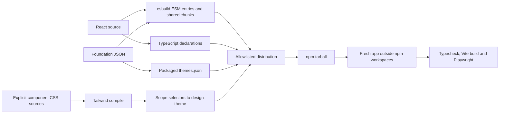

# Installable package build and verification

This guide describes distribution preparation. The package is now configured
public/MIT as `@inverse_ratio/design-system`; see [release setup](RELEASE_SETUP.md)
for the implemented workflows and pending external account settings. No package
has been published and no MCP server exists.

## Build pipeline



`packages/react/scripts/build.mjs` builds 71 ESM entry points (64 UI modules,
AI, root, theme, hooks and helpers), writes declarations and ensures relative
declaration imports have ESM-compatible extensions. UI/hook/AI entry points carry
client directives; pure theme resolution remains separate and importable in Node.
React/React DOM and other runtime dependencies remain external.

The distribution embeds foundation JSON in JavaScript, copies `themes.json`, and
contains every internal chunk required by the exported modules. `files` and
`sideEffects` in the manifest retain intended files/CSS while excluding the source
workspace and catalog. The package root and all public subpaths resolve to `dist`.

## CSS contract

The default package stylesheet compiles only explicitly listed component sources,
not gallery source. It includes semantic theme declarations, data-slot identity
styles, generated utilities and a minimal component baseline. Selectors are scoped
without rewriting keyframe percentages or double-prefixing nested rules.

There is no default global Preflight or host typography reset. `reset.css` is an
optional separate export. Applications with their own Tailwind pipeline may
continue to use it; applications without Tailwind import only compiled package
CSS. Modern CSS support is required; Chromium is the current browser test target.

## Run verification

```sh
npm run build:lib
npm run test:package
npm run build
npm run test:react
npm run check:react-sources
npm run test:static
```

The package runner builds before packing, uses `npm pack --ignore-scripts` for the
prepared artifact, validates its file list, and creates a unique temporary directory
under the operating system temporary directory. It installs the tarball normally, not as a directory symlink.
The clean consumer has no aliases, workspace source links or Tailwind dependency/plugin.
It typechecks all 64 UI entry contracts with `skipLibCheck: false` and builds them
through its own Vite setup. Runtime smoke checks import public UI/AI/hooks/helpers,
exercise pure theme resolution without a DOM, and compare physical React/React DOM
resolution between host and library to detect duplication.

Playwright covers:

- Compiled CSS without Tailwind and preservation of host margins.
- All 20 system/mode/accent combinations on portaled dialogs and opener focus.
- Form error recovery, a switch and keyboard tabs.
- Explicit AI confirmation and local chat streaming/stop.
- A narrow reduced-motion layout and screenshot.

The existing catalog suite separately mounts all 90 examples. Tests require
Playwright Chromium and permission to launch a local server/browser. The isolated
consumer also needs registry access or an adequately populated npm cache. Set
`DESIGN_NPM_CACHE` to choose a cache and `DESIGN_NPM_OFFLINE=1` for offline installs.
Temporary directories and cache defaults use Node’s operating-system temp directory.

## Reproducible evidence

The runner writes `artifacts/package/last-run.json` with status, isolated consumer
path, actual tarball path and SHA-256, and verification notes. Browser results and
screenshots go under `artifacts/package/browser-results/`. These generated files
are ignored by Git. A failed run remains failed in the report; only a fully
successful install/build/browser run is marked passed.

A future release candidate must preserve and approve the artifact digest from its
own release commit. A local test artifact is not authorization to publish. Package
trust configuration, approvers and remote release verification remain separate
checklist items. Package identity is approved and workflows are implemented.

## Readability and maintenance

Local React modules, identity CSS, catalog TSX and scripts are formatted with the
repository's Prettier configuration. Compound local state declarations are split
for readability. Upstream source is kept unchanged to preserve provenance.
`npm run snippets` regenerates copyable TSX and catalog metadata after example edits;
browser tests read the metadata rather than parsing formatting-sensitive source.
