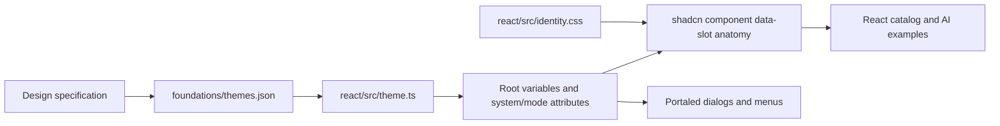

# Project structure and contributor guide

Status: describes the current repository. Release and MCP designs linked below
include implemented local npm workflows and a proposed MCP server. Remote npm/GitHub configuration remains unverified.

## Start here

1. Read [the system map](../design/DESIGN_SYSTEMS.md) to choose an identity.
2. Run the React catalog with `npm install` and `npm run dev` (Node 22.12+).
3. Reuse or change components in `packages/react/`; use the catalog to inspect them.
4. Follow [GitHub guidance](../../.github/DESIGN_SYSTEMS.md) when preparing changes.

The React catalog is the primary implementation. Root HTML pages are preserved
references. Neither the repository root nor its catalog applications is intended
to be published as a component package.

## Repository map

```text
design-system/
├── AGENTS.md                           Repository-wide agent guidance
├── README.md                           Quick start and documentation links
├── package.json / package-lock.json    npm workspaces, commands, locked dependencies
├── .agents/skills/
│   ├── design-system-forma/SKILL.md     Forma implementation guidance
│   ├── design-system-minimal/SKILL.md   Minimal implementation guidance
│   ├── design-system-nocturne/SKILL.md  Nocturne implementation guidance
│   ├── design-system-brutalism/SKILL.md Brutalism implementation guidance
│   └── design-library-github/SKILL.md   Central repository/GitHub routing
├── .github/
│   ├── DESIGN_SYSTEMS.md               Central human/agent contribution guide
│   └── copilot-instructions.md         Short GitHub Copilot entry point
├── docs/
│   ├── architecture/                  This guide and release/MCP proposals
│   └── design/
│       ├── DESIGN_SYSTEMS.md           Authority and identity routing
│       ├── FORMA_DESIGN_SPEC.md        Forma's independent specification
│       ├── systems/                    Separate Minimal, Nocturne, Brutalism references
│       ├── STRUCTURED_CHAOS_DESIGN_SPEC.md  Shared charter and accepted history
│       ├── Structured_Chaos_Master_Design_Document.docx  Review companion
│       ├── LIBRARY_SPEC.md             Library behavior and implementation boundaries
│       └── *COVERAGE.md                Native and React coverage/limits
├── packages/
│   ├── foundations/                   Shared exploratory theme registry + native adapter
│   ├── react/                         Primary reusable React/shadcn + AI source
│   └── components/                    Earlier native HTML/CSS/JS reference library
├── apps/
│   ├── react-library/                 React/Vite catalog and browser tests
│   └── library/                       Native catalog assets
├── scripts/                           TSX snippet generation and source checks
├── tests/                             Native/static/state-contract checks
├── index.html                         Native catalog entry point
├── structuredChaos.html              Original six-expression identity showcase
└── forma.html                         Original Forma showcase
```

Generated directories such as `node_modules/`, `dist/`, and `test-results/` are
ignored. npm workflow implementation is described in RELEASE_SETUP.md; no MCP server exists.

## The three implementation layers

| Layer | Responsibility | Change here when… |
| --- | --- | --- |
| Design specifications | Identity intent, semantic requirements, accepted versus exploratory choices | The design decision or identity contract changes |
| `packages/foundations/` | Theme values, accent families, typography directions, identity metadata | A shared expression or accent mapping changes |
| `packages/react/` | shadcn primitives, theme application, identity anatomy, reusable AI compositions | A real React component or its appearance/behavior changes |
| Catalog apps | Examples, navigation, search, preview and source display | Documentation or demonstration behavior changes |
| `packages/components/` | Native reference components and behavior | A supported native reference needs the same design correction |

The foundation is shared data; the React and native component APIs are distinct.
The native adapter writes `--bg`, `--surface`, and `.ds` state. The React adapter
maps the same registry into shadcn variables such as `--background`, `--card`,
and `--primary`, with `.design-theme` state. Do not mix their class/API contracts.

## How a React theme reaches a component



`themes.json` is the shared implementation-data file. `themes.js` mirrors it for
buildless browser pages; keep both synchronized. The React adapter imports the
JSON directly. `applyReactTheme()` defaults to the document root, so portals use
the active identity. One global theme is supported in the React catalog; isolated
multi-theme widgets require deliberate portal containment.

`styles.css` includes Tailwind declarations and the identity stylesheet.
`identity.css` controls anatomy—rules, radii, elevation, grouping and motion—using
shadcn `data-slot` attributes. Changing a preview wrapper alone does not update
the reusable component. `src/ui/` contains 64 upstream modules; `src/ai/` contains
local compositions built on them. Preserve the upstream license and provenance.

## Files most often edited

| Task | Main files |
| --- | --- |
| Change values/accents | `packages/foundations/themes.json`, matching `themes.js` |
| Change React variable mapping | `packages/react/src/theme.ts` |
| Change component identity | `packages/react/src/identity.css` |
| Change shared component behavior | Selected `packages/react/src/ui/*.tsx`; review upstream provenance |
| Add/revise AI patterns | `packages/react/src/ai/index.tsx` |
| Add a React example | `apps/react-library/src/ui-demos.tsx` or `ai-demos.tsx` |
| Change the React catalog shell | `apps/react-library/src/App.tsx`, `app.css` |
| Refresh copyable TSX | Run `npm run snippets`; commit `src/demo-usage.json` with the examples |
| Update native reference | `packages/components/`, `apps/library/` |
| Change design guidance | Relevant per-system MD, umbrella charter if shared, skills if instructions change |

## Commands and what they prove

| Command | Purpose |
| --- | --- |
| `npm run dev` | Serve the React catalog at `http://127.0.0.1:5173` |
| `npm run typecheck` | Typecheck the reusable React package |
| `npm run build:lib` | Build reusable ESM, declarations, compiled CSS and bundled data |
| `npm run build` | Build the library, then typecheck/build the catalog |
| `npm run test:package` | Pack, install outside workspaces and run consumer types/build/Playwright checks |
| `npm run snippets` | Extract working TSX compositions from catalog examples |
| `npm run check:react-sources` | Check coverage and parsing of 90 extracted examples |
| `npm run test:react` | Chromium checks for mounts, representative flows, theming and reflow |
| `npm run test:static` | Native registry, syntax/state contracts, references and DOCX integrity |

Browser tests require Playwright Chromium (`npm exec -- playwright install chromium`)
and permission to start a local server. Run checks proportionate to what changed;
document review does not require rebuilding unchanged UI. Existing browser checks
do not establish exhaustive contrast, screen-reader or cross-browser conformance.

## Related architectures

- [npm release and approval flow](RELEASE_SETUP.md): locally implemented; external setup pending.
- [Design MCP and application-consistency flow](MCP_ARCHITECTURE.md): proposal only.

The current installable artifact and its clean-consumer verification are documented
in [package build/testing](PACKAGE_BUILD_AND_TESTING.md). The library is configured public/MIT as `@inverse_ratio/design-system`;
npm account configuration and actual publication remain pending.
