# Release setup: @inverse_ratio/design-system

The owner approved **public access and MIT**. Version 0.1.0 was published manually
and its npm integrity was verified against the tested tarball. GitHub protection
and OIDC publishing still require account configuration and a successful remote run.

## Publish the next patch through Actions

A pending patch note in `.changeset/themed-package-guidance.md` requests 0.1.1
from the current 0.1.0 base. Commit it with the package README update and merge
into main. **Version packages** opens/updates a version/changelog PR. You can
also start that workflow from Actions → Version packages → Run workflow → main.
Review and merge its PR; **Release** then tests the new version and waits for
npm-production approval when publishing is enabled and protection is configured.
Do not create a release tag first or run Release while changeset notes are pending.
The workflows create the GitHub tag/release after npm publication succeeds.

## Configure accounts before enabling publication

1. Confirm your npm account has publish rights in `inverse_ratio` for
   `@inverse_ratio/design-system`. Retain both
   the local MIT license and upstream shadcn notices.
2. Review and commit the repository changes to `muditxsharma/design-system`.
   Enable Actions and allow GitHub Actions to create pull requests. Protect
   `main`, require review and the CI verification check. The version workflow
   explicitly dispatches CI on its Changesets branch because PR events created
   with `GITHUB_TOKEN` do not normally trigger another workflow.
3. Create the GitHub environment **npm-production**. Configure required reviewers,
   prevent self-review, disable administrator bypass, and permit protected
   branches only. Choose another eligible reviewer: someone who initiates a run
   cannot also approve it with self-review disabled. Confirm your GitHub plan
   supports these protections. The workflow reads the environment and branch
   through the API and fails closed when protections are missing or unreadable.
4. Configure npm trusted publishing for repository owner **muditxsharma**, repository
   **design-system**, workflow filename **release.yml**, environment
   **npm-production**. Allow direct publishing for this trusted publisher. This
   implementation uses GitHub-hosted runners, Node 24.12.0 and its bundled npm;
   npm requires at least npm 11.5.1 and Node 22.14.0 for trusted publishing.
   No long-lived `NPM_TOKEN` fallback is implemented.
5. Resolve the first-package bootstrap in your npm account. Do not assume the
   workflow can create a never-published package before its trust binding exists.
   If npm requires an initial owner-authenticated publish, review the exact
   tested tarball and separately authorize that initial publication, then bind
   the trusted publisher. Do not bypass the workflow by adding an unreviewed token.
6. After verifying those settings, set repository Actions variable
   **NPM_RELEASE_ENABLED=true**. While absent/false, candidates can be tested and
   uploaded but the publish and GitHub-release jobs are skipped.

Official setup references: [npm trusted publishers](https://docs.npmjs.com/trusted-publishers/),
[GitHub environment protection](https://docs.github.com/en/actions/reference/workflows-and-actions/deployments-and-environments),
[workflow event behavior](https://docs.github.com/en/actions/how-tos/writing-workflows/choosing-when-your-workflow-runs/triggering-a-workflow).

## Routine version and release flow

```mermaid
flowchart LR
  A[Component change + changeset] --> B[Merge reviewed change]
  B --> C[Changesets version PR]
  C --> D[Review and merge version/changelog]
  D --> E[Build + source/static checks + Playwright]
  E --> F[Tested tarball + digest + evidence]
  F --> G[Verify protection and current main]
  G --> H[npm-production human approval]
  H --> I[Recheck guards + publish exact artifact via OIDC]
  I --> J[Verify npm integrity + GitHub tag/release]
```

Run `npm run changeset` with a library change and select patch/minor/major.
Commit its Markdown note with the change. `version.yml` opens/updates a version
PR and never publishes; merging it starts `release.yml`. The initial 0.1.0
candidate needs no artificial changeset. Pending changeset notes defer publication
until a version PR consumes them. Stable releases use the npm `latest` channel;
prerelease versions are deliberately rejected by this initial workflow.

Before approving, inspect the candidate summary, source commit, version,
SHA-256 and artifact's verification.json. The workflow's candidate job runs
release contracts, source coverage, static/state checks, catalog Playwright and
five browser tests against an actual tarball installed in a clean app. Artifacts
are named by SHA and run attempt and retained for 14 days. Actions are pinned
by commit; `scripts/release/action-pins.json` records their upstream references.

Only the publish job has OIDC permission. It downloads the tested tarball,
checks its metadata, source SHA and digests, and publishes with scripts disabled.
It performs no install or rebuild. Branch/environment guards run again after
approval; an older candidate fails if main has advanced. Remote Actions/OIDC and
approval behavior still need an actual controlled run after account setup.

## Failure and recovery

- Failed checks produce no publishable candidate. Fix the change and rerun checks.
- Missing protection or a stale main commit stops publication. Correct settings
  or produce a candidate at the current commit; obtain approval again.
- Expired artifacts require a fresh candidate run and approval.
- Publish errors are followed by registry verification because npm may have
  accepted the artifact before a connection failed. Registry errors never count
  as a missing version. An existing version must have the exact expected integrity.
- If npm succeeded but finalization failed, rerun the original release at the same
  source SHA. Matching registry bytes are not republished; tags/releases are
  completed idempotently. A tag pointing to another commit is rejected.
- Conflicting bytes at an existing npm version require investigation and a new
  version. Never overwrite a released version or move an existing release tag.

Local verification: `npm run test:release`, `npm run test:package`,
`npm run check:react-sources`, `npm run test:static`, `npm run build:catalog`,
`npm run test:react`. Local fixtures test the guards and actual Changesets version
operation; they do not establish the state of your GitHub/npm accounts.
